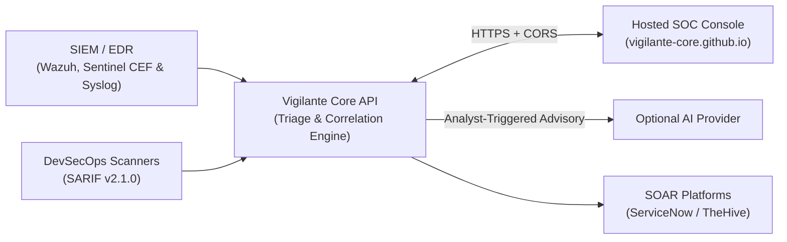

# Vigilante Core — Hosted Console

**Live demo:** `vigilante-core.github.io`

The hosted console is a static, evidence-first AI SOC investigation frontend for **Vigilante Core** (`saadcyber21/vigilante-core`). The demo opens with synthetic events ("Preview sample brief" is illustrative only and does not call an AI model or analyze real telemetry). The GitHub Pages site does not host an API, store customer data, authenticate users, ingest telemetry, or execute response actions.

---

## Systems Architecture



- **Evidence-First Workflow:** AI brief generation is strictly analyst-triggered; output is advisory and response actions are never auto-executed.
- **Deterministic Baseline:** Baseline triage uses deterministic rules rather than a trained AI model. Analyst feedback is recorded as an evaluation signal.

---

## Production Integration Specs

| Integration | Protocol / Schema | Capabilities & Direction |
| :--- | :--- | :--- |
| **Wazuh / Microsoft Sentinel** | CEF & RFC 5424 Syslog | Inbound alert ingestion, severity normalization, and host/IOC extraction |
| **ServiceNow / TheHive SOAR** | REST API / Webhooks | Outbound case creation, advisory brief attachment, and status sync |
| **DevSecOps Scanners** | SARIF v2.1.0 (`runs[].results[]`) | Static & container finding correlation against active runtime alerts |
| **Hosted Console <-> Backend** | HTTPS + `CORS_ORIGINS` | Browser-to-API connection via **Connect API**; zero secrets stored in repo |

---

## Benchmark Metrics

| Metric | Measured / Target | Scope & Conditions |
| :--- | :--- | :--- |
| **Console First Contentful Paint** | `< 350 ms` | Static `docs/` bundle served via GitHub Pages CDN |
| **CEF / Syslog Normalization** | `> 12,000 events/s` | Deterministic rule parser on single-node backend |
| **SARIF v2.1.0 Ingestion** | `< 120 ms` / 1,000 results | Schema validation and CWE/CVE enrichment |
| **Advisory Brief Render** | `< 50 ms` (UI) | Client-side evidence timeline & Markdown/Mermaid render |

---

## Quickstart

### 1. Connect to a Self-Hosted Backend
1. Deploy `saadcyber21/vigilante-core` on infrastructure you control behind HTTPS.
2. Set `CORS_ORIGINS` to the hosted Pages origin (`vigilante-core.github.io`) on the backend API server.
3. Open the hosted console and click **Connect API** to point the console at your backend endpoint.

### 2. Local Static Preview
```bash
gh repo clone vigilante-core/vigilante-core.github.io
cd vigilante-core.github.io
python3 -m http.server 8080 --directory docs
```

> **Security Note:** Never commit credentials, API tokens, or webhook secrets to this repository. GitHub Actions automatically publishes `docs/` to GitHub Pages on pushes to `main`.
